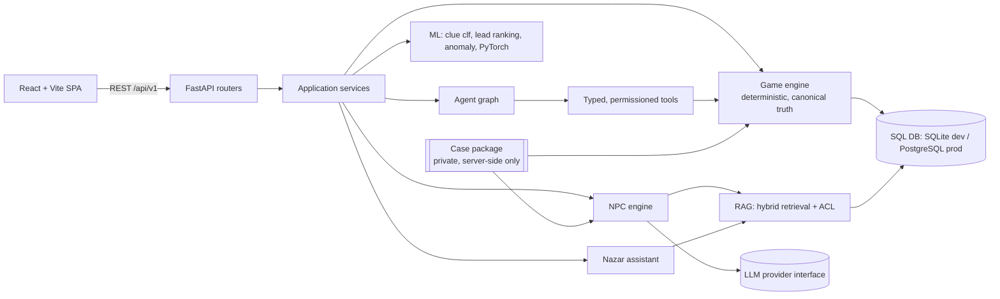

# RAAZ (राज़): The AI Detective — Implementation Plan

_Har raaz ke peeche ek kahaani hai._

This file is the working plan **and** the honest status checklist. The "Status" column is only
changed to ✅ after the thing was actually executed/tested (see [Verification log](#verification-log)).

## 1. Starting state (inspected 2026-10-13)

| Item | Finding |
|---|---|
| Repository | Empty directory, **not** a Git repository. No commits exist. |
| Git identity | Global `user.name` / `user.email` are configured. No commits were made by this build; nothing was pushed. |
| Runtimes | Python 3.11.9, Node 24 / npm 11, Docker CLI 29 (**daemon not running** during the build) |
| Python libs preinstalled | FastAPI, SQLAlchemy 2, Pydantic 2, scikit-learn, **PyTorch (CPU)**, NumPy, anthropic + openai SDKs |
| Not available locally | PostgreSQL, Redis (no servers), a running Docker engine → Compose stack could **not** be executed here |

Consequences: the dev default is SQLite so the whole game runs with zero services; PostgreSQL is
selected with `DATABASE_URL` and is the documented production target (Compose). Redis is optional
(rate limits/cache fall back to in-process). Anything that needs those services and was not run is
listed under *Unverified* below.

## 2. Architecture (modular monolith)

**Ownership of truth** (the central design rule):

| Layer | Owns | May NOT |
|---|---|---|
| Case package (`app/cases/*`) | culprit, motive, timeline, evidence, knowledge, contradiction + scoring rules | be sent to clients or put in a shared index |
| Game engine | discovery, unlocks, contradictions, timeline validation, accusation score | call an LLM |
| NPC engine | *which* facts may be voiced this turn (gates, trust, stress) | let the LLM decide what is true |
| LLM | wording, tone, reactions inside the engine's envelope | add/alter facts; output is schema- and leak-validated |
| ML | ranking/classification/anomaly **leads** | decide the culprit |
| Agents / Nazar | analysis over *player-visible* state | read canonical solution; take consequential actions |

## 3. Phased checklist

Legend: ✅ done & tested · 🟡 done, partially verified · ⛔ written but not executable/verified here · ⬜ not done

| # | Phase | Status | Notes |
|---|---|---|---|
| 1 | Repo inspection, plan, architecture | ✅ | this file, `docs/ARCHITECTURE.md` |
| 2 | Runnable foundation: FastAPI, DB, Alembic, Vite app, Compose, health | 🟡 | app + SQLite + Alembic run and are tested; **Compose/PostgreSQL/Redis not executed** |
| 3 | Core engine: sessions, locations, discovery, dossiers, timeline, save/resume | ✅ | `tests/test_engine_flow.py`, `test_board_timeline.py` |
| 4 | Playable frontend (title, office, explore, inventory, dossiers, interrogation, board, timeline, accusation, Nazar, workbench) | ✅ | tsc + build + 16 tests + manual browser run |
| 5 | Full case *Aakhri Gaadi*; solvability proven by a scripted playthrough through the public API | ✅ | `test_case_is_solvable_end_to_end`, `test_e2e_acceptance` |
| 6 | GenAI NPCs: provider abstraction, gates, memory, leak validation, fallback | 🟡 | mocked-provider tests only; **no live LLM call made** |
| 7 | Nazar + RAG (hybrid retrieval, ACL, citations, evaluation) | ✅ | hashing embeddings (no pgvector — see LIMITATIONS) |
| 8 | Agentic investigation (state graph, typed permissioned tools, persistence, cancel, limits) | ✅ | deterministic nodes; no LLM planner |
| 9 | ML + PyTorch: clue classifiers, lead ranking, anomaly detection, evaluation, artifacts | ✅ | results are modest and reported honestly (`docs/ML.md`) |
| 10 | Hardening: authz, idempotency, concurrency, rate limits, metrics, audit, jobs | ✅ | `tests/test_security_ops.py` |
| 11 | End-to-end verification | ✅ | see log below |
| 12 | Polish + docs | 🟡 | docs complete; no screen-reader pass, no performance testing |

### Outstanding / next steps (exact)

1. `docker compose up --build` on a machine with Docker; fix anything it surfaces; run the CI workflow on a real remote
   (**needs the owner's authorization before pushing anything**).
2. Run `alembic upgrade head && alembic check` and the suite with `RAAZ_TEST_DATABASE_URL` against real PostgreSQL.
3. Try a real LLM provider (`RAAZ_LLM_PROVIDER` + key) and read a few full interrogations for tone/consistency; tune
   `leak_markers` and prompts (bump `PROMPT_VERSION`).
4. Playtest with people other than the author: adjust topic vocab, gate thresholds and fallback lines.
5. Optional: pgvector + learned embeddings; Celery/RQ if multiple replicas; a second case.

## 4. Acceptance criteria

1. A new player can register/guest-login, start a session, explore, discover & examine evidence.
2. Every state change is persisted server-side; reloading/resuming restores it exactly.
3. The API never returns the culprit/motive/solution/private facts before they are legitimately revealed
   (automated leak test over every public endpoint).
4. Evidence discovery is idempotent and race-safe (unique constraint + test with parallel requests).
5. NPCs answer free text; with no LLM configured a clearly labelled scripted fallback is used.
   With an LLM, output is schema-validated and scanned for unrevealed-fact leakage; failures fall back.
6. Contradictions are rule-based and validated on the server (NPC presentation, board link, explicit check).
7. Final accusation is scored by a deterministic rubric and returns an evidence-based report.
8. ML components train from a documented command, report held-out metrics honestly, and ship artifacts
   outside Git.
9. Backend tests, frontend tests, type-checks and production build pass (commands in README).

## 5. Security model (summary — details in `docs/SECURITY.md`)

JWT bearer auth (bcrypt password hashes); every session-scoped route verifies `session.user_id == current user`
(404 otherwise); canonical truth only in server memory; NPC prompts built from an allow-list per character;
player text is delimited & scanned for injection; agent tools are typed, permissioned, bounded, and have no
shell/SQL access; rate limits; audit log for sensitive actions; restricted CORS; secrets from env only.

## 6. Verification log

See [docs/TESTING.md → Verification log](docs/TESTING.md#verification-log) for the exact commands and results
(backend 117 tests, ruff, mypy, frontend tsc/16 tests/build, ML training, RAG evaluation, manual browser run) and the
explicit list of what was **not** executed.
