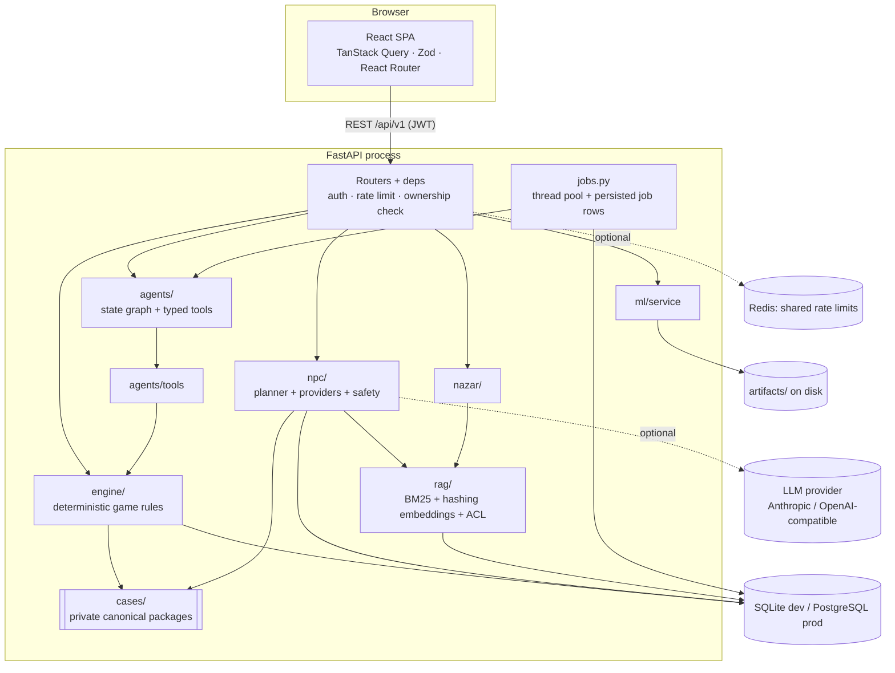
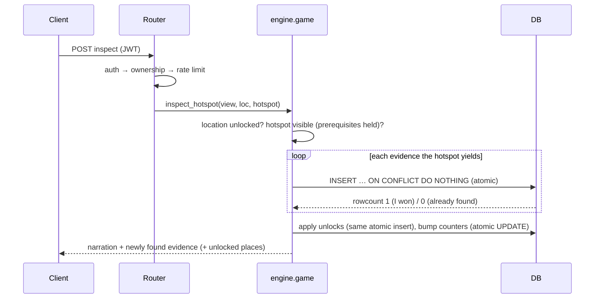

# Architecture

RAAZ is a **modular monolith**: one FastAPI process, one SQL database, one React SPA. There are no microservices
because nothing here needs independent scaling yet (see [When to split](#when-separate-services-become-justified)).



## State ownership

| State | Owner | Where it lives | Client sees |
|---|---|---|---|
| Case truth (culprit, motive, true timeline, knowledge, rules, scoring) | Case package | Python modules, memory only | never; only projections of what the player has earned |
| Public catalog (case title, location/character/evidence *names*) | Engine | `cases`, `locations`, `characters`, `evidence` tables | yes |
| Player progress (discoveries, examined flags, unlocks, contradictions, disclosures) | Engine | `evidence_discoveries`, `unlocked_locations`, `contradictions_found`, `disclosures` | own only |
| Conversations, trust/stress, memories | NPC engine | `conversations`, `messages`, `character_memories`, `rag_chunks(scope=dialogue/memory)` | own only; trust shown as a band |
| Board, timeline entries, hypotheses | Player (validated by engine) | `board_*`, `timeline_entries`, `hypotheses` | own only |
| Accusations, reports | Engine | `accusations`, `reports` | own only |
| Agent runs & steps | Agent runner | `agent_runs`, `agent_steps` | own only |
| ML experiments & model versions | ML registry | `ml_experiments`, `model_versions` + files | dev workbench |

Every session-scoped route resolves the session through one dependency (`deps.session_view`) which returns **404**
for both "does not exist" and "belongs to someone else", so there is no existence oracle.

## Request flows

**Search a hotspot** (`POST …/locations/{l}/hotspots/{h}/inspect`)



**Talk to a suspect** (`POST …/conversations/{c}/messages`)

```mermaid
sequenceDiagram
  participant C as Client
  participant N as npc.dialogue
  participant L as LLM (optional)
  participant D as DB
  C->>N: text (+ evidence_key)
  N->>N: validate evidence is held; sanitise text; injection scan
  N->>N: PLAN: pick facts (topic score / evidence triggers), evaluate gates (trust, stress, evidence, prerequisites),
  N->>N: decide voiced facts, granted evidence, contradictions, trust/stress deltas (deterministic)
  alt provider configured and budget left and no injection
    N->>L: prompt = persona + only the allowed beats + prior statements (no secrets)
    L-->>N: JSON {reply, mood}
    N->>N: schema check + leak-marker scan (else retry once, else fallback)
  else
    N->>N: scripted fallback lines for the same plan
  end
  N->>D: one short transaction guarded by conversation.version (optimistic concurrency)
  N-->>C: reply, mood, labelled generation mode, new evidence, contradictions
```

The LLM call happens **outside** any DB transaction; the commit is conditional on the conversation `version`
being unchanged, so two concurrent messages to one suspect cannot both write (one gets `409 still_answering`).

## Concurrency & consistency

* **One-time clues:** discoveries, unlocks, contradictions and disclosures use `INSERT … ON CONFLICT DO NOTHING`
  on a composite primary key; exactly one concurrent request observes `rowcount = 1`
  (`tests/test_security_ops.py::test_parallel_inspections_discover_each_clue_exactly_once`).
* **Counters/versions:** atomic `UPDATE … SET actions = actions + 1` — no read-modify-write.
* **Accusations:** `UPDATE game_sessions SET attempts = attempts + 1 … WHERE attempts = :expected AND status = 'active'`;
  a lost race gets `409` and no attempt is double-spent. `Idempotency-Key` replays return the stored response.
* **Conversations:** optimistic `version` column (above).
* SQLite runs in WAL mode with a busy timeout; PostgreSQL uses a pooled engine with `pool_pre_ping`.

## Caching decisions

* **Server:** nothing is cached that depends on player state (correctness over speed; every read is a small indexed
  query). The shared RAG corpus is rebuilt only when a case's content hash changes. ML models are cached in-process
  after first load. Redis is used only for rate-limit counters when `RAAZ_REDIS_URL` is set (falls back in-process).
* **Client:** TanStack Query with 5 s `staleTime`; after any action `useRefreshGame` invalidates derived queries.
* Responses carry `Cache-Control: no-store`.

## Background jobs

`jobs.submit()` runs work on an in-process thread pool and persists a `jobs` row (status, attempts, error). Transient
errors (`TimeoutError`, `ConnectionError`) retry with exponential backoff up to a bound; other errors fail
immediately and are recorded. Agent runs use it with `max_attempts=1` (the graph has its own limits). The pool is
shut down gracefully on application shutdown.

This is deliberately **not Celery**: with one API process it provides the observable guarantees (status, retries,
failure reporting) without a broker. If you run several API replicas, or need workers scaled independently, replace
`jobs.submit` with Celery/RQ + Redis — callers only use `submit()`/`wait()`.

## Failure recovery

| Failure | Behaviour |
|---|---|
| LLM timeout / 5xx / rate limit | bounded retries with backoff → scripted fallback, labelled; counted in metrics |
| LLM returns invalid JSON, leaks, markup or meta-language | one stricter retry → fallback |
| Token budget for a conversation exhausted | fallback with reason `token_budget_exhausted` |
| Agent node raises / exceeds iterations or time | run marked `failed` with error; steps so far remain; player can start another |
| Redis unavailable | rate limiter falls back to in-process (fails open on errors) |
| ML artifacts missing/corrupt | features degrade to heuristic baseline / no tags; gameplay unaffected |
| Process restart mid-agent-run | the run stays `running` in the table (no resume); documented limitation |
| DB constraint race | handled by atomic inserts / conditional updates (see above) |

## Expected bottlenecks

1. **LLM latency/cost** — a turn is one provider call (plus at most one retry). Mitigated by per-conversation
   token budgets and per-user rate limits.
2. **RAG scan** — retrieval loads the *filtered* candidate chunks and ranks in NumPy. Fine for hundreds of chunks per
   case; thousands per request would call for an ANN index (pgvector) — see Limitations.
3. **Single-process job pool** — long agent runs share 4 threads.
4. **SQLite writer lock** — dev only; production uses PostgreSQL.

## When separate services become justified

* *Inference* if several large models are served (separate GPU/CPU scaling).
* *Workers* when agent runs or ML training must scale independently of request latency.
* *Dialogue* if streaming (SSE/WebSocket) conversations dominate connections.
* Not before: the current coupling is a feature (one transaction boundary per player action).

## Streaming

Server-sent events / WebSockets were **not** added: replies are short, and polling (`/investigations/{id}`) is enough
for agent progress. If added, authorise on connect with the same JWT and re-check ownership on reconnect.
