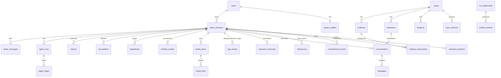

# Database schema

SQLAlchemy 2.x models in [`backend/app/models.py`](../backend/app/models.py); migration
[`0001_initial_schema`](../backend/alembic/versions/0001_initial_schema.py) (generated from the models; a test
asserts the migrated schema has no drift: `tests/test_security_ops.py::test_alembic_migration_matches_models`).
Dev default is SQLite; production target is PostgreSQL (`RAAZ_DATABASE_URL=postgresql+psycopg://…`). JSON columns use
the portable `JSON` type.



## Tables

| Table | Purpose | Notable constraints / indexes |
|---|---|---|
| `users`, `player_profiles` | accounts (bcrypt hash) or guests | unique `email`; profile FK cascade |
| `cases`, `case_versions` | catalog + content hash per version | unique (`case_id`, `version`) |
| `locations`, `characters`, `evidence` | **public** catalog columns only (names/categories) | composite PK (`case_id`, `key`) |
| `game_sessions` | one investigation | `CHECK attempts >= 0`; `version` token; index (`user_id`, `updated_at`) |
| `unlocked_locations` | places the player may enter | PK (`session_id`, `location_key`) |
| `evidence_discoveries` | one row per collected item (examined flag) | PK (`session_id`, `evidence_key`) = the one-time-clue lock; composite FK → `evidence` |
| `contradictions_found` | established conflicts | PK (`session_id`, `rule_key`) |
| `disclosures` | facts a character has voiced (`public` stated account / `reveal` truth) | PK (`session`, `character`, `fact`, `kind`) |
| `conversations`, `messages` | dialogue + trust/stress/mood/token usage | unique (`session_id`, `character_key`); unique (`conversation_id`, `seq`); `version` for optimistic concurrency |
| `character_memories` | evidence seen, things said, summaries | index (`session_id`, `character_key`) |
| `rag_chunks` | retrieval corpus: `case_doc`, `evidence`, `character` (global) and `dialogue`/`memory` (per session) | ACL columns: `session_id`, `character_key`, `required_evidence`; embeddings stored as JSON |
| `board_items`, `board_links` | investigation board; links carry `validated`/`rule_key` | unique pin per (`session`, `kind`, `ref_key`); unique link per (`session`, `from`, `to`, `relation`) |
| `timeline_entries`, `hypotheses` | player reconstruction / theories | – |
| `accusations`, `reports` | scored attempts and generated reports | unique (`session_id`, `attempt_no`) |
| `agent_runs`, `agent_steps` | agent execution history (summaries, refs, status, timing) | unique (`run_id`, `idx`) |
| `nazar_messages` | assistant history | – |
| `jobs` | background-job status | – |
| `ml_experiments`, `model_versions` | experiment tracking | unique (`name`, `version`) |
| `audit_events` | sensitive actions (auth, session create, accusation, agent start) | index `user_id` |
| `idempotency_keys` | replay protection for accusations | PK (`user_id`, `route`, `key`) |

## Access patterns

* Load a session view: five small primary-key/`session_id`-indexed selects (discoveries, unlocks, contradictions,
  disclosures, conversations). All gameplay computations are done on that in-memory view.
* Writes are single-row atomic inserts/updates (see ARCHITECTURE → Concurrency).
* RAG retrieval filters on (`case_id`, `scope`, `session_id`, `character_key`) in SQL, re-checks ACL in Python, then
  ranks with NumPy.

## Migrations

```bash
cd backend
alembic upgrade head                      # apply
alembic revision --autogenerate -m "…"    # after changing models.py
alembic check                             # CI: fail on drift
```

The container entrypoint runs `alembic upgrade head` before starting the API. **Not yet run against a real
PostgreSQL by the author** — the CI workflow has a job for that.

## Backups

SQLite: copy the `.db` file while the app is stopped (or use `sqlite3 .backup`). PostgreSQL: `pg_dump` on a schedule
and test restores; the `pgdata` Compose volume is *not* a backup. ML artifacts (`artifacts/`) are reproducible with
`python -m app.cli train-ml` and need not be backed up.
