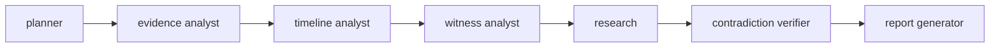

# RAG and agent workflows

## RAG (`backend/app/rag`)

| Piece | Implementation |
|---|---|
| Ingestion | `ingest.py`: sentence-aware chunking (~480 chars, 60 overlap) with metadata; idempotent per case content hash + embedder name (marker chunk); per-session dialogue/memory chunks added at runtime |
| Embeddings | `HashingEmbedder` — hashed word 1-2-grams + char 3-5-grams, log-scaled, L2-normalised (512 dims), plus a small domain synonym map. **A lexical-morphological embedding, not a learned semantic model.** Behind an `Embedder` protocol so a hosted/learned model can be swapped in |
| Lexical | Okapi BM25 over the ACL-filtered candidate set |
| Fusion & rerank | Reciprocal Rank Fusion of dense + BM25, then an optional query-term-coverage rerank |
| Storage | `rag_chunks` table, embeddings as JSON; cosine in NumPy. **pgvector is not used** (no PostgreSQL available to test); at this corpus size (a few hundred chunks) a vector index adds nothing, and the swap point is `store.retrieve` |
| Citations | every hit has `source_ref` (`doc:…`, `ev:…`, `evx:…`, `fact:…`) returned to the client by Nazar |

### Access control (the important part)

`store.retrieve` filters **before** ranking and re-checks after, using: case · requested scopes · `session_id`
(global or this session) · `character_key` (character-scoped knowledge only for the requested NPC; never when none is
named) · `required_evidence` (the player must hold it) · `requires_examined` (examination notes only after examining).
The canonical solution is **not** indexed. Character facts are indexed per character, so one NPC cannot retrieve
another's knowledge. Retrieved text is treated as data: imperative/injection lines are stripped before entering a
prompt and the text is delimited. Tests: `tests/test_assistant.py::test_rag_*`.

### Retrieval evaluation

`python -m app.cli rag-eval` — 24 hand-labelled queries against the fully-unlocked corpus:
**recall@1 0.833 · recall@3 0.958 · recall@5 0.958 · MRR 0.896**; one miss ("why is the station clock wrong").
Small and authored alongside the corpus: a regression guard (`test_rag_retrieval_quality_regression_guard` requires
recall@3 ≥ 0.85, MRR ≥ 0.7), not a benchmark.

## Agent investigations (`backend/app/agents`)

An explicit state machine (LangGraph-style, no dependency):

* **Typed shared state** (`AgentState`, Pydantic): tasks, findings, timeline, witness statements, documents,
  candidates, verified conflicts, hypotheses, caveats, report.
* **Tools** (`tools.py`): search evidence, get evidence, read statements, compare timestamps, clock status, list
  timestamps, travel time, candidate contradictions, alibi status, retrieve documents, evaluate hypothesis. Each has a
  Pydantic argument model (`extra="forbid"`, bounded numbers). There is **no shell, SQL, network or write tool**, and
  the canonical-solution objects are not reachable from this module.
* **Permissions** are enforced inside the tool layer, not trusted to the agent: reading evidence the player does not
  hold, or travel times for places they have not visited, raises `ToolDenied` and is recorded as a `denied` step.
* **Bounds:** max iterations (`RAAZ_AGENT_MAX_ITERATIONS`, 12), wall-clock deadline (25 s), one active run per session,
  runs/hour per session, request-rate limit, cancellation checked between nodes.
* **Persistence:** `agent_runs` + `agent_steps` (node, tool, args, a *concise reasoning summary*, referenced evidence,
  status, duration). No chain-of-thought is stored.
* **Agents propose, players decide:** the verifier lists candidate contradictions with provenance and returns
  `suggested_player_actions`; it never records a contradiction. The UI's "I confirm this contradiction" button calls
  the same explicit endpoint a player would.
* **Deterministic first:** planning is keyword-based and the nodes are deterministic over typed tools — no LLM is
  required for investigations. The graph is where an LLM planner/narrator could be plugged in later.

Tests: `tests/test_assistant.py` (trace persisted, report limited to held evidence, tool authorization, iteration
limit, timeout, cancellation, node failure, cross-player isolation).
